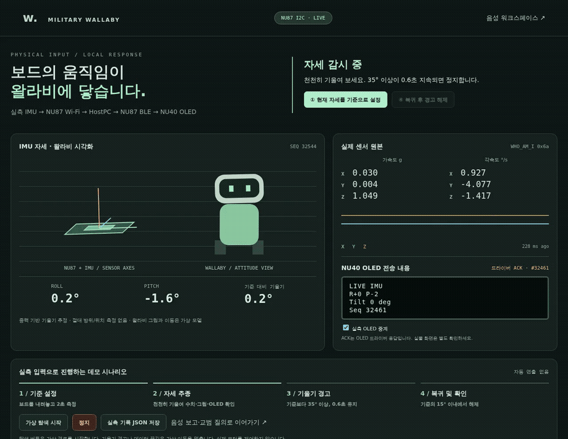
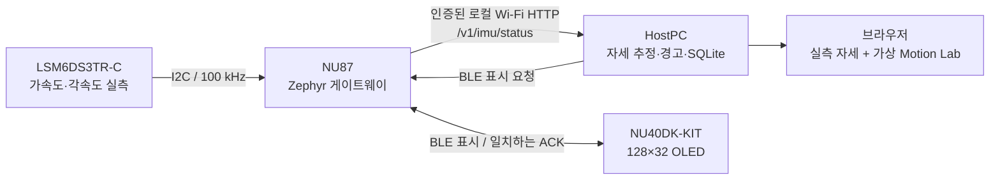

# NU87 실측 IMU → NU40 OLED 데모

**[실측 GIF](media/07-live-imu.gif) · [MP4](media/military-wallaby-live-imu.mp4) ·
[측정·검증 JSON](live-imu-evidence.json)**



2026-10-11 실제 NU87의 IMU를 사용자가 기울여 진행한 녹화입니다.
원본 화면 녹화에서 대기 구간만 잘랐고 재생 속도는 1배입니다.
왈라비 그림과 주행 경로는 가상 모델이며, 입력·기울기 판정·Wi-Fi·BLE·OLED 응답은 실제 장비를 사용합니다.
센서 입력 생성이나 음성 자막으로 시나리오를 실행하지 않았습니다.

## 하드웨어 구성



| 연결 | 실제 구성 |
| --- | --- |
| 센서 전원 | 3.3V / GND |
| I2C SDA / SCL | NU87 PA26 / PA25 |
| 주소 / 식별 응답 | `0x6a` / `WHO_AM_I=0x6a` |
| NU87 전원 | PC USB. 측정 데이터는 Wi-Fi로 수신 |
| NU40 전원 | USB 보조배터리. PC 연결 없이 BLE로 OLED 표시 |
| 펌웨어 | NU87의 Wi-Fi·BLE 앱에 선택형 IMU 수집 통합. NU40 기존 앱 유지 |

검증된 센서 초기화와 I2C 드라이버 수정을 재사용합니다. 시료 순번·가동 시간·데이터 나이·
센서 식별값·원본 6축·오류 수를 함께 읽습니다. 센서가 응답하지 않으면 임의 값을 채우지 않습니다.

## 현장 시연

실측 화면 **<http://127.0.0.1:8767/hardware.html>**을 엽니다.
음성·보고 워크스페이스는 **<http://127.0.0.1:8767/>**입니다.

1. 센서를 내려놓고 `NU87 I2C · LIVE`, 증가하는 `SEQ`, `WHO_AM_I 0x6a`를 확인합니다.
2. **현재 자세를 기준으로 설정**을 누릅니다. 2초 이상, 최소 12개의 새 실측값으로
   기준 중력 방향을 계산합니다. Wi-Fi 지연 시 최대 20초 기다리며, 움직이는 중에는 설정을 거절합니다.
3. **가상 탐색 시작**을 누르고 센서를 천천히 좌우로 기울입니다.
   화면 자세·원본 6축과 NU40 OLED의 `R/P/Tilt/Seq` 변화를 확인합니다.
4. 기준보다 약 45° 기울여 2초 유지합니다. **35° 이상이 0.6초 지속**되면
   기울기 경고를 기록하고 가상 이동을 정지하며 OLED에 `TILT - STOP`을 전송합니다.
5. 원래 자세로 돌린 뒤 **복귀 후 경고 해제**를 누릅니다. 새 측정값이 기준의
   15° 이내일 때만 해제합니다. 탐색은 다시 눌러야 시작합니다.
6. **실측 기록 JSON 저장**으로 입력·기준·이벤트·ACK를 내보냅니다.
   기준 설정·경고·해제는 같은 HostPC의 SQLite 이력에도 저장됩니다.

보고를 이어서 시연하려면 음성 워크스페이스에서 **상황 보고** 모드를 선택하고
`상황 보고. 위치: 훈련장. 관측: 이동 장치 기울기 경고. 조치: 정지 후 자세 확인. 요청: 점검.`을
입력하거나 직접 말합니다. 음성은 준비된 로컬 STT가 필요합니다. 보고 속 이동 표현은 실행하지 않습니다.
음성 처리 기능은 [별도 확인 영상](VOICE-CHECK.md)에 기록했고, 이 IMU 녹화에서는 실행하지 않았습니다.

## 부드러운 표시

사용자가 OLED 숫자 변화를 확인한 뒤 더 부드러운 감도를 요청하여 표시를 보완했습니다.
HostPC는 표시 자세에 시정수 240ms의 지수 평활을 적용하고, 브라우저는 160ms의 보간으로
프레임 사이를 이어 줍니다. OLED에는 평활한 자세를 약 1.2초 간격으로 전송합니다.
위 녹화는 이 표시 보완을 적용하기 전의 실제 입력입니다.

원본 가속도·각속도, 경고 임계값과 이벤트 기록은 평활하지 않습니다.
새 순번이 1.5초 이상 들어오지 않거나 자세 추정이 유효하지 않으면 이동을 차단합니다.
큰 동적 가속도에서는 정확한 기울기를 주장하지 않으며 절대 방위·위치를 추정하지 않습니다.
음성 응답·수동 요약을 OLED에 보냈을 때는 8초 유지합니다. 경고·연결 끊김 표시는 우선합니다.

## 실행과 빌드

이미 연결된 보드는 RESET이나 재기록 없이 다음 HostPC 명령으로 사용합니다.
`<NU87-IP>`에는 실제 DHCP 주소를 넣습니다. 비밀번호와 API 토큰은 Git 제외 `local.conf`에서 읽습니다.

```bash
voice_tactical/.venv/bin/python -m voice_tactical.server --no-browser \
  --gateway '<NU87-IP>:8080' \
  --gateway-config firmware/nu87_lcd_gateway/local.conf \
  --auto-display --live-imu
```

기존 이력은 같은 `--data-dir`로 유지합니다. STT·LLM은
[Linux 안내](../../voice_tactical/LINUX.md)의 설정을 추가합니다.
NU40이 해제되어 있다면 음성 워크스페이스의 **BLE 목록 조회 → 주소/종류 선택 → 선택 연결**을 사용합니다.

새 보드는 [NU87 빌드·기록 안내](../../firmware/nu87_lcd_gateway/LINUX.md)를 따른 뒤
`bash firmware/nu87_lcd_gateway/build.sh --imu`로 빌드합니다.
IMU 옵션 없는 기존 게이트웨이는 계속 사용할 수 있지만 실측 IMU를 제공하지 않습니다.
현재 보드는 `flash_linux.py --write --auto-boot`로 자동 BOOT 진입과 기록을 수행했습니다.
펌웨어·생성 헤더·모델·비밀번호·토큰은 저장소에 포함하지 않습니다.

## 실제 확인 결과

| 항목 | 관측 |
| --- | --- |
| 센서 입력 | 실제 NU87 I2C, 새 순번 증가, 센서 오류 0 |
| 녹화 중 상대 기울기 | 0.042°–46.502° |
| 기준 설정 | 시료 `25708`의 측정값·기준 벡터를 SQLite 저장 |
| 기울기 경고 | 시료 `32977`, 상대 기울기 45.386° |
| 정지 전달 | NU87의 `stop` 명령 `accepted=true`. 실제 모터 없음 |
| 복귀·해제 | 시료 `33093`, 상대 기울기 1.539°, SQLite 해제 이벤트 저장 |
| NU40 OLED | 일치하는 드라이버 ACK. 사용자도 R/P·Seq 값 변화를 확인 |
| 브라우저 녹화 | 실제 시간, 생성 센서값·합성 음성 입력 없음, JavaScript 오류 없음 |

영상의 OLED 영역은 **전송 내용과 드라이버 ACK**이며 실물 화면 촬영이 아닙니다.
JSON에서 자동 확인과 사용자 실물 관찰을 구분했습니다. 원본 연속 녹화와 개발 로그는
로컬 Git 제외 `build/live-imu-recording/`에 있습니다.

## 검증과 재녹화

```bash
python3 -m unittest discover -s voice_tactical/tests
node --test simulation/*.test.mjs simulation/tests/*.test.mjs voice_tactical/web/*.test.mjs
python3 -m unittest discover -s firmware/nu87_lcd_gateway/tests
make -C firmware/nu87_imu_bringup/tests test
```

HostPC Python 125개, JavaScript 52개, NU87 HTTP·업로드·연결 Python 77개를 통과했습니다.
센서·I2C 회귀 검사와 NU87 Zephyr 빌드도 통과했습니다.
단위 테스트의 고정 입력은 테스트 전용이며 실행 중인 실측 모드에는 재생 경로가 없습니다.

실제 앱을 대상으로 브라우저 확인과 녹화를 실행합니다. Playwright Chromium과 FFmpeg가 필요합니다.

```bash
WALLABY_PLAYWRIGHT_MODULE=/path/to/playwright/index.mjs \
  node voice_tactical/tests/browser-live-imu.mjs
WALLABY_PLAYWRIGHT_MODULE=/path/to/playwright/index.mjs \
  node docs/demo/record-live-imu.mjs --publish
```

첫 명령은 읽기만 수행합니다. 두 번째는 사용자가 실제 센서를 기울이는 동안 화면을 녹화하고,
기준이 설정되면 가상 탐색을 시작합니다. 실제 자세가 돌아오면 경고를 해제합니다.
새 센서 순번·실제 경고·해제 이벤트·OLED ACK가 확인된 녹화만 `--publish`로 복사합니다.
입력을 생성하거나 서버를 모사하지 않습니다. `WALLABY_LIVE_SECONDS`로 실제 대기 시간을
10–600초 범위에서 지정합니다. 저장소 업로드는 녹화와 별도로 수행합니다.

얼굴·수평계 OLED와 주행 공간 조작은 [OLED-GRAPHICS.md](OLED-GRAPHICS.md)를 참고하세요.
