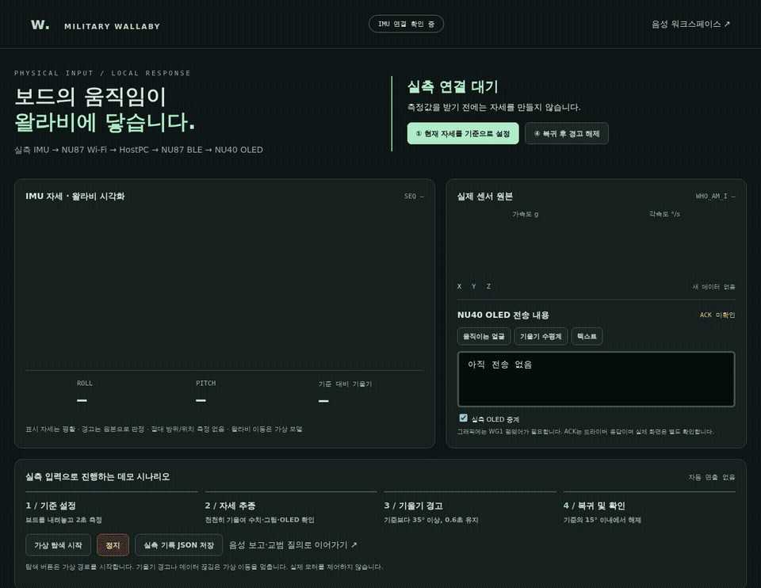

# 실측 IMU → OLED 그래픽 → 주행 시뮬레이션

**[실기 연동 GIF](media/08-oled-graphics.gif) ·
[MP4](media/military-wallaby-oled-graphics.mp4) ·
[검증 기록](oled-graphics-evidence.json)**



이 영상은 실측 서버에서 얼굴·수평계·텍스트를 선택하고 가상 탐색과 키보드 주행을
조작한 26.32초의 실제 시간 녹화입니다. 센서는 책상에 내려놓은 상태이며,
센서값을 생성하지 않았습니다. OLED 영역은 전송 장면과 ACK를 표시하며 실물 촬영은 아닙니다.

실행 주소: <http://127.0.0.1:8767/hardware.html>.
이 페이지는 실제 NU87의 I2C 측정값을 사용합니다. 주행 공간의 왈라비는 가상 모델이며,
실제 바퀴 모터나 XY 위치 센서는 연결하지 않았습니다.

## 조작 순서

1. NU87+IMU와 NU40의 전원을 켜고, NU87을 HostPC와 같은 Wi-Fi에 연결합니다.
   NU40은 보조배터리로 켜 두어도 됩니다. 대시보드에서 `NU87 I2C · LIVE`와 새 SEQ를 확인합니다.
2. 보드를 내려놓고 **현재 자세를 기준으로 설정**을 누릅니다. 12개의 새 측정값과 최소
   2초의 안정 구간이 필요합니다. 느린 Wi-Fi에서는 최대 20초까지 기다립니다.
3. **움직이는 얼굴** 또는 **기울기 수평계**를 누릅니다. NU40의 WG1 지원 펌웨어가
   실제 IMU 값으로 그래픽을 그립니다. **텍스트**를 누르면 기존 R/P/Tilt/Seq 표시로 돌아갑니다.
4. IMU를 천천히 기울입니다. 얼굴의 눈동자와 수평계가 실제 roll/pitch를 따라갑니다.
   눈 깜빡임은 NU40에서 실행하는 장식 애니메이션이며 센서 측정값을 생성하지 않습니다.
5. **가상 탐색 시작**을 누르면 아래 Motion Lab에서 순찰 경로를 시작합니다.
   화면 속 방향 패드나 WASD/화살표도 사용할 수 있습니다. 키보드는 먼저 주행 공간을
   클릭해야 합니다. Space 또는 페이지의 **정지**로 멈춥니다.
6. 기준보다 35° 이상 기울인 상태를 0.6초 유지하면 가상 주행이 멈추고 `TILT STOP`
   경고 도형을 표시합니다. 기준의 15° 안으로 돌려놓은 뒤 **복귀 후 경고 해제**를 누릅니다.

실측 기울기는 왈라비의 허리·머리 자세에 연결합니다. IMU를 기울이는 동작만으로
주행 경로나 XY 좌표를 추측하지 않습니다. `SIM PATROL`은 마지막 가상 순찰 요청의 표시이며
실제 모터 동작 증거가 아닙니다. 이 표시는 정지/센서 차단 시 또는 60초 뒤 해제됩니다.

## 작은 OLED의 표시

128×32 단색 화면의 왼쪽 64픽셀에 얼굴, 수평계, 경고 또는 연결 끊김 도형을 그립니다.
오른쪽에는 상태, R/P/T와 측정 순번이 나타납니다. 긴 순번은 마지막 9자리만 표시하며
HostPC에는 전체 순번을 보관합니다. 렌더링은 약 120ms 간격입니다. Wi-Fi/BLE의 센서 전송
간격과 별개이며, 이 주기로 새로운 센서 데이터를 측정했다는 의미는 아닙니다.

전송이 3초 이상 없거나 같은 측정 순번만 반복되면 NU40이 `LINK STALE`로 바꿉니다.
활성 기울기 경고와 BTN4 훈련 경보는 오래된 데이터 때문에 자동 해제하지 않습니다.
BTN4의 `SIM ALERT`는 훈련용 버튼 이벤트이며 실제 위험물 감지가 아닙니다.

음성 처리 결과 카드는 약 8초 동안 텍스트로 표시한 뒤 실측 화면으로 돌아갑니다.
경고나 연결 끊김은 이 표시 대기보다 우선합니다. 키트의 물리 경보는 장치에서도
우선 표시하므로 실측 얼굴 화면이 경보를 덮지 않습니다.

대시보드의 OLED 미리보기는 **HostPC에서 그린 전송 장면**입니다. 실물 화면의 촬영본이
아닙니다. ACK는 해당 BLE 순번과 OLED 드라이버 전송 결과를 확인합니다. 물리 화면의
가시성은 직접 관찰해야 합니다.

## 프로토콜과 펌웨어

기존 ACK 기반 TEXT 특성에 아래 3행 ASCII 명령을 보냅니다. NU87의 영상 스트리밍이나
새 BLE 서비스는 필요 없습니다. 기존 펌웨어는 명령을 글자로 표시할 수 있으므로,
WG1 지원 펌웨어를 설치한 다음 그래픽을 선택합니다. 서버 시작 시 기본값은 텍스트입니다.

```text
@WG1 H L
-12 11 16
202748
```

`H`는 수평계, `F`는 얼굴이며 두 번째 행은 roll/pitch/tilt의 정수 각도입니다.
세 번째 행은 NU87의 실제 측정 순번입니다. 상태는 `L` 실측, `R` 기준 미설정,
`C` 기준 측정, `P` 가상 순찰 요청, `S` 가상 정지, `A` 기울기 경고,
`B` 버튼/훈련 경보, `X` 측정 끊김입니다. 잘못된 예약 명령은 BAD_TEXT로 거부합니다.

NU40 소스 저장소:
[nu40-ble-display / feat/military-oled-graphics](https://github.com/mzsz94/nu40-ble-display/tree/feat/military-oled-graphics).
HostPC·NU87 작업은 `test/military-wallaby`에서 이어진 `feat/military-wallaby-oled-graphics`에 있습니다.
현재 저장소의 `firmware/nu40_voice`는 함께 빌드하고 검증하는 같은 소스의 사본입니다.

## BLE 업데이트 연결 점검

교체 전 실기 점검에서 NU87은 NU40의 마이크·경보 서비스를 정상 준비했지만,
SMP OTA 준비가 `-13`으로 실패했습니다. NU40에 SMP 서비스는 발견되었으나
NU87 빌드에 개인 페어링 코드가 설정되지 않은 상태였습니다. 이 결과는
일반 OLED BLE 통신 실패나 SMP 서비스 부재를 의미하지 않습니다.

공유 코드를 별도의 600 권한 파일에 보관하고 두 빌드에 같은 파일을 전달합니다.
Wi-Fi PSK, 토큰, 코드, 서명 키와 펌웨어 산출물은 커밋하지 않습니다.
최초 USB 프로비저닝과 이후의 서명된 BLE 업데이트 절차는
[`firmware/nu40_voice/README.md`](../../firmware/nu40_voice/README.md)를 따릅니다.

두 보드에 같은 개인 코드를 적용한 뒤, NU87의 인증된 BLE SMP 중계로 NU40의
활성·확정 이미지 `0.2.0`을 조회했습니다. 장치가 보고한 이미지 해시는
`543863dfe6a4f89f3e0895ca75fa45de3f95511ee2111eb630260104acfa41e8`로
이번 빌드와 일치합니다. 이번 버전은 USB로 설치했으며, 이미지 조회 성공만으로
전체 OTA 업로드·시험 부팅·확정·복구를 다시 검증했다고 주장하지 않습니다.

## 2026-10-11 실기 확인

NU40의 기존 애플리케이션을 로컬에 백업하고 공장 UF2 복구 영역과 MBR을 보존한 채
`0.2.0`을 설치했습니다. USB 로그에서 `firmware=3`, `graphics=WG1`, `oled_init=0`을
확인했습니다. 이후 NU40은 보조배터리로, NU87+IMU는 PC USB로 전원을 공급했습니다.

사용자가 **얼굴이 보이고 기울이면 반응함**을 확인했습니다. 자동 검사는 실제
NU87 I2C 순번과 오류 0, 얼굴·수평계·텍스트의 일치하는 OLED ACK를 확인합니다.
HostPC 미리보기와 실물 관찰은 별개의 증거로 기록합니다.

| 검사 | 실제 관측 |
| --- | --- |
| OLED 얼굴 / 수평계 / 텍스트 | 측정 순번 `83179` / `83575` / `83749`의 드라이버 ACK |
| 가상 탐색 | X `1.00 → 1.67m`, 방향 `0.0 → 5.0°` |
| W 키 주행 | X `1.68 → 1.75m`, Y `1.20 → 1.23m` |
| Space 정지 | 표시 선속도·각속도 0 |
| 실제 브라우저 검사 | JavaScript 오류 0, 마지막 얼굴 ACK 순번 `84745` |
| 회귀 검사 | Python 134개, JavaScript 52개 통과 |

가상 주행 좌표는 Motion Lab의 모델 상태입니다. 이 녹화에서 새로운 물리 기울기 경고
시나리오를 실행한 것은 아닙니다. 이전 실제 기울임·정지·복귀 영상은
[LIVE-IMU.md](LIVE-IMU.md)에 별도로 보관합니다.

OLED ACK 대기가 센서 읽기를 지연시키던 HostPC 처리를 분리했습니다. NU87의 단일
HTTP 리스너에 소켓 요청이 겹치지 않도록 직렬화하고, 실측 OLED 연속 전송에서는
성공 ACK로만 갱신되는 3초짜리 연결 상태를 재사용해 불필요한 상태 조회를 줄였습니다.
실패하거나 연결 대상을 바꾸면 재확인합니다. 센서 신선도 1.5초와 OLED 만료 3초는
완화하지 않았습니다. 느린 Wi-Fi에서는 `IMU_HOLD` 또는 `LINK STALE`로 멈출 수 있습니다.

초기 연결 점검에서 NU87의 반복 부팅을 관측했습니다. USB 직렬 포트를 다시 열 때도
부팅 로그가 발생했으므로, 정상 연결 뒤에는 HTTP로 확인합니다. 리셋 원인은 별도
확인이 필요하며, USB 포트 변경이나 서버 폴링만을 원인으로 확정하지 않았습니다.

### LINK STALE 수신 지연 조사

추가 조사에서는 BLE 연결과 OLED ACK, NU87 가동 시간이 계속 유지되는 동안 HostPC의
새 IMU 수신 간격이 최대 약 2.8초까지 벌어졌습니다. 0.4초 간격의 상태 조회 30회 중
4회가 1.5초 신선도 기준을 넘었으며, 당시 센서 오류는 0이었습니다. `LINK STALE`는
새 데이터의 만료 표시이며, 그 자체로 BLE 단절이나 NU87 재부팅을 뜻하지 않습니다.

요청마다 연결을 생성하던 HTTP 처리를 짧은 연결 재사용 방식으로 변경했습니다.
NU87은 명시적으로 요청한 클라이언트만 재사용하며, 최대 8회 요청 또는 4초의 세션
예산이 지난 응답 뒤에 연결을 닫습니다. 다음 요청이 750ms 동안 없으면 닫습니다.
HostPC는 마지막 응답 후 400ms 안에서만 연결을 재사용합니다. 각 요청을 인증하고,
실패한 명령을 자동 재전송하지 않습니다. 작은 JSON 응답은 헤더와 본문을 한 번에
전송합니다. 1.5초 센서 신선도와 3초 OLED 만료 기준은 변경하지 않았습니다.

HostPC 회귀 138개, NU87 Python 검사 77개, 네이티브 KIT/SMP/오디오 검사와 HTTP
파서 45항목을 통과하고 NU87용 Zephyr 펌웨어를 빌드했습니다. 보드 적용 후 실측
수신 간격을 별도로 비교해야 하며, 빌드와 테스트만으로 끊김 해결을 확정하지 않습니다.

실물 IMU를 책상에 내려놓고 기존 실행 서버에서 다음 실기 검사를 수행할 수 있습니다.
이 검사는 화면 선택·가상 탐색·W 키 주행·Space 정지를 실제로 조작합니다.
센서값이나 시간을 생성하지 않습니다. `--record`는 원본 녹화를 Git 제외 `build/`에 저장합니다.

```bash
WALLABY_PLAYWRIGHT_MODULE=/path/to/playwright/index.mjs \
  node voice_tactical/tests/browser-oled-scenario.mjs --calibrate --record
```

## 검증

```bash
python3 -m unittest discover -s voice_tactical/tests
node --test simulation/*.test.mjs simulation/tests/*.test.mjs voice_tactical/web/*.test.mjs
~/zephyrproject/.venv-3.12/bin/python -m unittest discover -s firmware/nu40_voice/tests
```

C 렌더러 테스트는 AddressSanitizer와 UndefinedBehaviorSanitizer로 잘린 명령,
손상된 필드, 정수 오버플로, 모든 roll 각도에서의 픽셀 경계, 글자 길이,
경고/끊김 우선순위를 검사합니다. 빌드 성공이나 미리보기만으로 실물 검증을 대신하지 않습니다.
