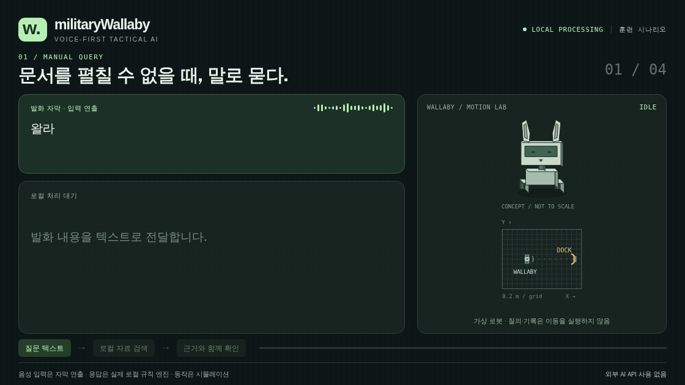
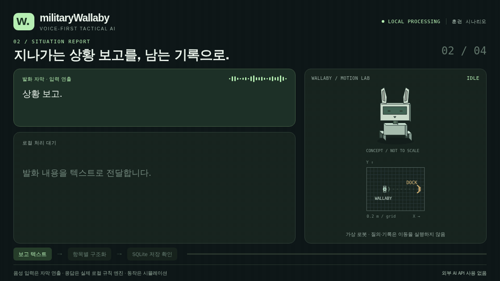
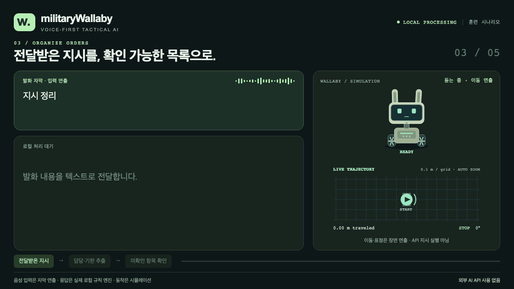
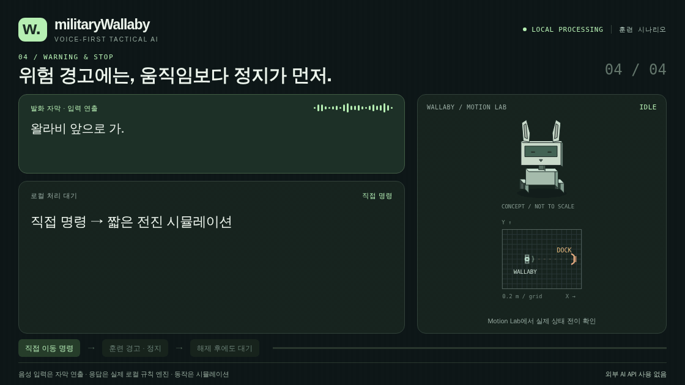
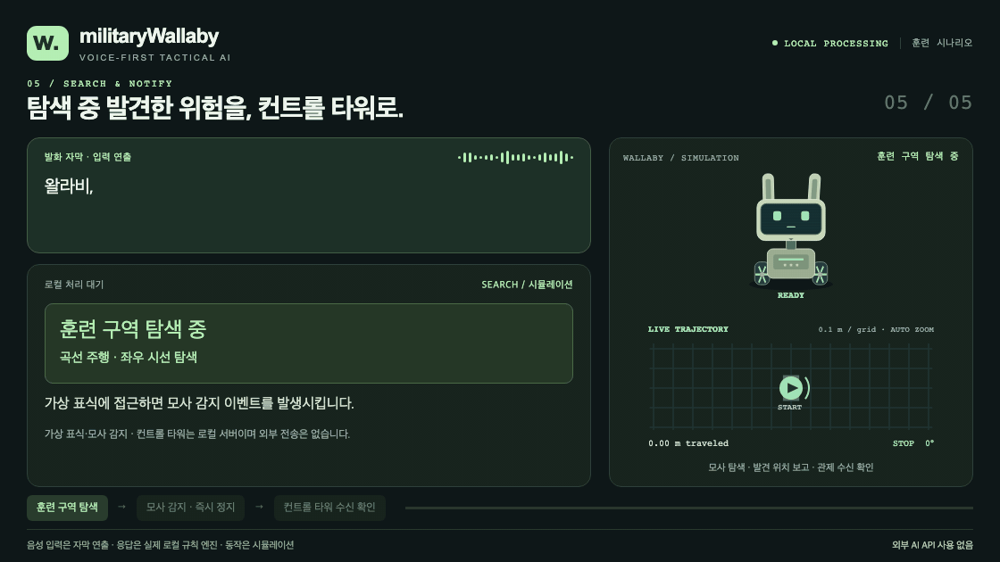

# militaryWallaby 상황별 데모

**[실측 하드웨어 데모·시연 순서](LIVE-IMU.md)** — 실제 IMU 기울임 → NU87 Wi-Fi →
기울기 경고·가상 정지 → BLE → NU40 OLED 응답을 확인한 녹화입니다.
[실측 GIF](media/07-live-imu.gif) · [MP4](media/military-wallaby-live-imu.mp4) ·
[측정·SQLite 이벤트](live-imu-evidence.json).
`http://127.0.0.1:8767/hardware.html`에서 같은 장비로 직접 시연합니다.

[상세 프로젝트 보고서](../military-wallaby-report.md) · [실행·보드 연결·OTA 안내](../../voice_tactical/README.md)

**[실제 로컬 음성 → OLED ACK 영상](VOICE-CHECK.md)** — 합성 WAV를 실제 Whisper·llama.cpp로
처리한 별도 녹화입니다. 아래의 5개 상황 영상은 자막 입력·시뮬레이션 시연입니다.

## 프로젝트 목적

- **외부망 없이 음성으로 교범 질의·상황 보고 요약·표준 보고 양식 변환·지시사항 정리를 수행하는 핸즈프리 전술 AI 인터페이스 개발.**
- microWallaby의 미니 프로젝트로서, 장비 운용과 전방 관찰로 손과 시선을 쓰기 어려운 상황의 정보 처리 지원.
- NU40DK 컨트롤 타워·NU87 Tiny 왈라비·HostPC 로컬 AI를 연결하여 음성 입력, 상태 표시, 경고 전달과 가상 동작 시연.
- 가상 왈라비의 탐색 → 모의 폭발물 발견 → 즉시 정지 → 컨트롤 타워 보고 흐름 구현.

## 기술스택

- **AI는 HostPC에서 로컬 실행하고, NU87·NU40는 BLE·Wi-Fi로 음성·명령·경고·업데이트 데이터를 전달하는 구조.**
- **보드·펌웨어:** NU40DK PDM 마이크·OLED·BTN4·경고 스피커, NU87 Tiny BLE/Wi-Fi 게이트웨이, Zephyr RTOS·C.
- **음성·언어 처리:** faster-whisper·로컬 Whisper 모델, OpenAI 호환 로컬 LLM 인터페이스, Ollama·Qwen 검증 환경, PC 로컬 한국어 TTS.
- **검색·기록:** 로컬 JSON 훈련 자료 검색, 원문 기반 규칙 추출, SQLite 보고·지시 기록 저장.
- **웹·시뮬레이션:** Python 로컬 HTTP 서버, HTML·CSS·JavaScript, Canvas 기반 Motion Lab.
- **BLE OTA:** MCUmgr SMP·MCUboot·ECDSA P-256 서명 이미지, 인증된 BLE 연결을 통한 NU40 펌웨어 갱신.

## 해결하고자 하는 문제

- **손과 시선을 확보하면서 구두 정보를 기록·정리·검색할 수 있는 정보 처리 방식 마련.**
- **키보드·화면 조작 부담:** 음성 입력과 응답으로 질의·보고·재확인 지원.
- **음성 정보의 휘발성:** 보고와 지시의 원문·요약·처리 결과를 저장하여 누락과 반복 정리 감소.
- **외부망 의존성:** 사전 준비한 모델과 자료로 통신 단절 환경에서도 로컬 처리 지원.
- **비정형 보고·교범 탐색 부담:** 발화를 보고 항목으로 구조화하고 관련 자료와 출처 제시.
- **이상 상황 전달 지연:** 모사 감지 후 즉시 정지하고 발견 위치·경고 상태를 컨트롤 타워에 보고.
- **유선 업데이트 부담:** NU87을 중계기로 활용한 BLE OTA로 NU40 펌웨어의 반복 USB 갱신 작업 감소.

## NU87·NU40 BLE OTA

- **NU87은 OTA 중계 보드, NU40는 서명된 펌웨어를 수신·적용하는 대상 보드.**
- **전송 경로:** HostPC 업데이트 도구 → 로컬 Wi-Fi HTTP → NU87 → 인증된 BLE SMP → NU40 MCUboot.
- **첫 설치:** NU40에 호환 MCUboot와 서명 앱을 USB로 설치한 뒤, 이후 펌웨어를 BLE OTA로 갱신.
- **업데이트 절차:** 서명 이미지 업로드 → 시험 부팅 → 기능 확인 → 명시적 확정. 미확정 이미지에는 MCUboot 복귀 절차 적용.
- **현재 범위:** NU40 OTA 중계 경로 구현·빌드 완료. 실제 보드의 OTA·전원 차단 복구 검증은 별도 수행 대상이며, NU87 자체 BLE OTA는 현재 구현 범위에 포함되지 않음.

## 통합 시연 영상

교범 질의·상황 보고·지시사항 정리와 탐색·관제 보고를 다섯 가지 훈련 시나리오로
구성했습니다. 왈라비의 표정, 고개·몸·바퀴 움직임과 지도 위 이동 궤적이 장면에 따라
바뀝니다. 1120×630, 8fps. 개별 장면은 12초, 통합본은 60초입니다. GIF에는 소리가 없습니다.

**[통합 GIF](media/military-wallaby-overview.gif) · [MP4 영상](media/military-wallaby-demo.mp4)**


| 장면 | 영상 | 처리 흐름과 왈라비 반응 |
| --- | --- | --- |
| 문서를 펼칠 수 없을 때 | [교범 항목 조회](media/01-manual-query.gif) | 곡선 이동·듣는 표정 → 생각하는 표정 → 근거 확인·끄덕임 |
| 지나가는 보고를 기록으로 | [상황 보고 구조화](media/02-situation-report.gif) | 반대 방향 곡선 이동 → 항목 대조·좌우 시선 → SQLite 저장 확인·기쁜 표정 |
| 전달받은 지시 정리 | [담당·기한 확인](media/03-organize-orders.gif) | 완만한 S자 이동 → 담당·기한 대조 → 빠진 기한에 고개를 기울이며 재확인 대기 |
| 경고 시 왈라비 정지 | [훈련 경고와 정지](media/04-warning-stop.gif) | 직접 전진 명령 반복 → 경고 표정·급정지 → 추가 이동 거절 → 해제 후에도 대기 |
| 탐색 후 컨트롤 타워에 알림 | [탐색·발견·관제 보고](media/05-search-and-notify.gif) | 곡선 주행·좌우 탐색 → 가상 표식 접근·모사 감지 → 정지·발견 위치 보고 → 관제 수신 확인 |

## 장면별 시연 GIF

### 01 교범 질의

- **질문을 듣고 로컬 자료를 조회한 뒤, 근거를 확인하며 끄덕이는 장면.**
- 곡선 이동 궤적과 듣기 → 생각 → 확인 표정 변화 표시.



### 02 상황 보고 구조화

- **보고를 항목별로 정리하고 SQLite 저장을 확인하는 장면.**
- 반대 방향 곡선 이동, 항목 대조를 위한 좌우 시선, 저장 후 기쁜 표정·끄덕임 표시.



### 03 지시사항 정리

- **담당·기한을 대조하고, 빠진 기한은 미확인으로 남겨 재확인을 기다리는 장면.**
- 완만한 S자 이동 후 고개를 기울이며 재확인이 필요한 표정 표시.



### 04 경고와 정지

- **직접 전진 명령으로 움직이다가 훈련 경고에 즉시 정지하는 장면.**
- 경고 표정, 궤적·바퀴 정지, 추가 이동 거부와 해제 후 대기 표시.



### 05 탐색·발견·컨트롤 타워 보고

- **왈라비가 구역을 탐색하다 모의 폭발물 표식을 발견하면 정지하고 컨트롤 타워에 알리는 장면.**



왈라비는 훈련 구역을 이동하며 고개를 좌우로 움직입니다. 가상 표식 근처에 도착하면
모사 감지 이벤트가 발생하고 즉시 정지하며 표정과 궤적 표시가 경고 색상으로 바뀝니다.
발견 위치와 정지 상태를 로컬 보고 API로 전달하고, 컨트롤 타워 역할의 로컬 서버에서
해당 보고를 다시 조회한 뒤에만 **수신 확인**을 표시합니다. 확인 이후에도 경고와 정지는
유지합니다. 위치는 시뮬레이션 격자 좌표이며, 실제 폭발물 탐지나 외부 관제망 전송은 아닙니다.

## 영상에서 실제로 실행한 것

응답은 현재 `voice_tactical` 서버의 `/api/turn`에서 생성했습니다. 보고 저장은
`/api/records`로 다시 확인했고, 로봇은 기존 Motion Lab의 Canvas와 상태 전이를
재사용했습니다. 궤적과 바퀴 회전은 실제 운동학 모델 값이며 미리 그린 경로가 아닙니다.
듣기·생각·확인·재확인·경고·대기 표정과 관절 목표를 장면 시간에 맞춰 적용합니다.

첫 세 장면의 이동은 데모 연출이며 질의·보고·지시의 API 결과가 이동 명령을 실행한
것이 아닙니다. 녹화 전용 `?demo=1` 임베디드 모드에만 연출 인터페이스가 활성화되며,
일반 Motion Lab의 조작 방식은 유지합니다. 연출 입력이 끊기거나 창이 비활성화되면
이동이 중단되고, 경고 중에는 연출로도 이동·관절 제어를 재개할 수 없습니다.

녹화 중 각 장면의 0.2 m 이상 이동·궤적·표정 전환과 고개 움직임을 검사합니다.
경고 이후 선속도·각속도 0, 위치 고정, 추가 이동 거절, 해제 후 대기와 탐색 보고의
관제 수신 확인도 검사합니다.

음성 입력은 보고서의 사용 상황을 보여 주는 **자막 연출**입니다. 이 녹화는 실제
STT·LLM·TTS 추론, 이어셋, NU87·NU40 하드웨어를 사용하지 않았습니다. 응답은 현재의
로컬 규칙·근거 검색 경로이며, 자료는 저장소의 개발용 훈련 예시입니다. 공식 교범
질의나 현장 성능을 검증한 영상으로 해석하지 마세요. 이 범위는 영상 하단에도 표시합니다.

현재 앱의 선택형 STT 엔진은 faster-whisper이며, 이 GIF에서는 해당 모델을 실행하지 않았습니다.
상단 기술스택 설명과 영상에서 실제로 실행한 범위는 구분합니다.

## 현장 시연과 영상 재생성

### GIF와 같은 화면으로 현장 시연

저장소 루트에서 시나리오 전용 서버를 실행합니다. 이미 실행한 음성·보드 앱(8767)은
유지하고, 별도 기록 디렉터리를 사용합니다.

```sh
python3 -m voice_tactical.server --no-browser --port 8768 \
  --data-dir build/live-scenario-demo/data
```

**http://127.0.0.1:8768/demo/?play=1**을 열고 **전체 5장면 재생**을 누르면 약 60초 동안
교범 질의 → 상황 보고 → 지시 정리 → 경고·정지 → 탐색·관제 보고를 순서대로 재생합니다.
장면을 선택해 한 장면만 재생하거나 **정지**할 수도 있습니다. 창을 숨기거나 다른
창으로 전환하면 정지합니다. 멈춘 뒤 재생하면 장면 처음부터 시작합니다.

GIF와 동일하게 입력은 자막 연출이고, 응답·보고 저장은 실제 로컬 규칙 API이며,
표정·주행은 시뮬레이션입니다. 이 서버에는 게이트웨이·LLM을 설정하지 않습니다.
실제 마이크·WAV·LLM·NU87·NU40 연동은 **http://127.0.0.1:8767/**에서 시연합니다.
기본 앱의 `훈련구역탐색 시작해.`는 네 지점 순회이고, GIF의 곡선 탐색·가상 표식 발견은
이 시나리오 페이지에서 재생합니다.

### 영상 파일 다시 만들기

Node.js, Python 3, FFmpeg, Chromium과 Playwright가 필요합니다. 예를 들어 저장소
루트에서 녹화 도구를 Git 제외 경로에 설치하고 실행할 수 있습니다.

```sh
npm install --prefix build/demo-recorder playwright@1.64.0
build/demo-recorder/node_modules/.bin/playwright install chromium
WALLABY_PLAYWRIGHT_MODULE="$PWD/build/demo-recorder/node_modules/playwright/index.mjs" \
  node docs/demo/record.mjs
```

`--preview`를 붙이면 GIF를 인코딩하지 않고 각 장면의 중간 표정·감지 전환·마지막 화면과 검증 기록을 만듭니다.
`WALLABY_PYTHON`과 `WALLABY_DEMO_PORT`로 Python 실행 파일과 녹화용 포트를 바꿀 수 있습니다.

녹화기는 별도 로컬 서버와 SQLite를 `build/scenario-gifs/`에 만들며, 현재 실행 중인
앱이나 보드 설정은 변경하지 않습니다. 외부 브라우저 요청은 차단합니다. 프레임·로그·
전체 API 응답은 `build/`에, 공유용 GIF·MP4는 `docs/demo/media/`에 저장합니다.

[검증 요약](verification.json)은 녹화 완료 시 자동 갱신되며 파일별 길이·프레임 수·SHA-256과
장면별 이동량·표정·고개 움직임·이벤트를 기록합니다. MP4도 동일 프레임으로 함께 갱신합니다.

별도로 수행한 [NU87 Wi-Fi · NU40 BLE 실기 확인](HARDWARE-CHECK.md)은 영상의
시뮬레이션 범위와 구분해 기록했습니다.
