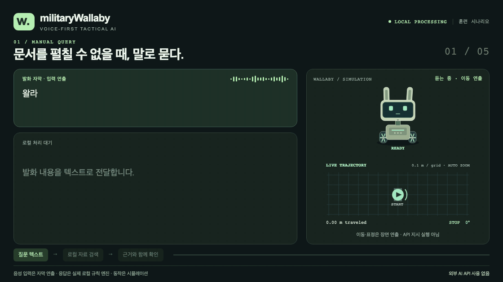

# militaryWallaby 상황별 데모

[프로젝트 보고서 · 목적·기술스택·BLE OTA 구성](../military-wallaby-report.md)

교범 질의·상황 보고·지시사항 정리와 탐색·관제 보고를 다섯 가지 훈련 시나리오로
구성했습니다. 왈라비의 표정, 고개·몸·바퀴 움직임과 지도 위 이동 궤적이 장면에 따라
바뀝니다. 1120×630, 8fps. 개별 장면은 12초, 통합본은 60초입니다. GIF에는 소리가 없습니다.

**[통합 GIF](media/military-wallaby-overview.gif) · [MP4 영상](media/military-wallaby-demo.mp4)**



| 장면 | 영상 | 처리 흐름과 왈라비 반응 |
| --- | --- | --- |
| 문서를 펼칠 수 없을 때 | [교범 항목 조회](media/01-manual-query.gif) | 곡선 이동·듣는 표정 → 생각하는 표정 → 근거 확인·끄덕임 |
| 지나가는 보고를 기록으로 | [상황 보고 구조화](media/02-situation-report.gif) | 반대 방향 곡선 이동 → 항목 대조·좌우 시선 → SQLite 저장 확인·기쁜 표정 |
| 전달받은 지시 정리 | [담당·기한 확인](media/03-organize-orders.gif) | 완만한 S자 이동 → 담당·기한 대조 → 빠진 기한에 고개를 기울이며 재확인 대기 |
| 경고 시 왈라비 정지 | [훈련 경고와 정지](media/04-warning-stop.gif) | 직접 전진 명령 반복 → 경고 표정·급정지 → 추가 이동 거절 → 해제 후에도 대기 |
| 탐색 후 컨트롤 타워에 알림 | [탐색·발견·관제 보고](media/05-search-and-notify.gif) | 곡선 주행·좌우 탐색 → 가상 표식 접근·모사 감지 → 정지·발견 위치 보고 → 관제 수신 확인 |

## 추가 시나리오: 탐색·발견·관제 보고

왈라비는 훈련 구역을 이동하며 고개를 좌우로 움직입니다. 가상 표식 근처에 도착하면
모사 감지 이벤트가 발생하고 즉시 정지하며 표정과 궤적 표시가 경고 색상으로 바뀝니다.
발견 위치와 정지 상태를 로컬 보고 API로 전달하고, 컨트롤 타워 역할의 로컬 서버에서
해당 보고를 다시 조회한 뒤에만 **수신 확인**을 표시합니다. 확인 이후에도 경고와 정지는
유지합니다. 위치는 시뮬레이션 격자 좌표이며, 실제 폭발물 탐지나 외부 관제망 전송은 아닙니다.

## 영상에서 실제로 실행한 것

응답은 현재 `voice_tactical` 서버의 `/api/turn`에서 생성했습니다. 보고 저장은
`/api/records`로 다시 확인했고, 로봇은 기존 Motion Lab의 Canvas와 상태 전이를
재사용했습니다. 궤적과 바퀴 회전은 실제 운동학 모델 값이며 미리 그린 경로가 아닙니다.
듣기·생각·확인·재확인·경고·대기 표정과 관절 목표를 장면 시간에 맞춰 적용합니다.

첫 세 장면의 이동은 데모 연출이며 질의·보고·지시의 API 결과가 이동 명령을 실행한
것이 아닙니다. 녹화 전용 `?demo=1` 임베디드 모드에만 연출 인터페이스가 활성화되며,
일반 Motion Lab의 조작 방식은 유지합니다. 연출 입력이 끊기거나 창이 비활성화되면
이동이 중단되고, 경고 중에는 연출로도 이동·관절 제어를 재개할 수 없습니다.

녹화 중 각 장면의 0.2 m 이상 이동·궤적·표정 전환과 고개 움직임을 검사합니다.
경고 이후 선속도·각속도 0, 위치 고정, 추가 이동 거절, 해제 후 대기와 탐색 보고의
관제 수신 확인도 검사합니다.

음성 입력은 보고서의 사용 상황을 보여 주는 **자막 연출**입니다. 이 녹화는 실제
STT·LLM·TTS 추론, 이어셋, NU87·NU40 하드웨어를 사용하지 않았습니다. 응답은 현재의
로컬 규칙·근거 검색 경로이며, 자료는 저장소의 개발용 훈련 예시입니다. 공식 교범
질의나 현장 성능을 검증한 영상으로 해석하지 마세요. 이 범위는 영상 하단에도 표시합니다.

보고서에 제안한 whisper.cpp·llama.cpp·Silero VAD·임베딩 RAG의 구현이나 성능을 이
영상만으로 주장하지 않습니다. 현재 앱의 선택형 STT 엔진은 faster-whisper입니다.

## 재생성

Node.js, Python 3, FFmpeg, Chromium과 Playwright가 필요합니다. 예를 들어 저장소
루트에서 녹화 도구를 Git 제외 경로에 설치하고 실행할 수 있습니다.

```sh
npm install --prefix build/demo-recorder playwright@1.64.0
build/demo-recorder/node_modules/.bin/playwright install chromium
WALLABY_PLAYWRIGHT_MODULE="$PWD/build/demo-recorder/node_modules/playwright/index.mjs" \
  node docs/demo/record.mjs
```

`--preview`를 붙이면 GIF를 인코딩하지 않고 각 장면의 중간 표정·감지 전환·마지막 화면과 검증 기록을 만듭니다.
`WALLABY_PYTHON`과 `WALLABY_DEMO_PORT`로 Python 실행 파일과 녹화용 포트를 바꿀 수 있습니다.

녹화기는 별도 로컬 서버와 SQLite를 `build/scenario-gifs/`에 만들며, 현재 실행 중인
앱이나 보드 설정은 변경하지 않습니다. 외부 브라우저 요청은 차단합니다. 프레임·로그·
전체 API 응답은 `build/`에, 공유용 GIF·MP4는 `docs/demo/media/`에 저장합니다.

[검증 요약](verification.json)은 녹화 완료 시 자동 갱신되며 파일별 길이·프레임 수·SHA-256과
장면별 이동량·표정·고개 움직임·이벤트를 기록합니다. MP4도 동일 프레임으로 함께 갱신합니다.
