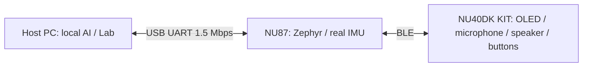

# NU87 USB Host transport

`feat/wallaby-usb-lab` adds a persistent USB data/control path. The NU87 still
uses BLE for the NU40 OLED, microphone, alarm and authenticated MCUboot SMP.
Host inference remains on the PC. Motors are not attached; motion is virtual.



No AP association, DHCP or Internet is needed in USB mode. Realtek's shared RF
must still initialize before BLE. The host acknowledges only the exact observed
empty-EFUSE startup prompt, once; no EFUSE/OTP write operation is performed.

## Build and run

Use the existing private `local.conf` (API token) and private pairing config.
Neither is committed. Start from the documented gateway workspace setup.

```sh
GATEWAY_BUILD_DIR="$PWD/build/nu87-usb-gateway" \
  bash firmware/nu87_lcd_gateway/build.sh --imu \
  '-DEXTRA_CONF_FILE=program.conf;local.conf;imu.conf;usb-host.conf;/absolute/private-pairing.conf'
python3 -m pip install -r voice_tactical/requirements.txt
python3 -m voice_tactical.server --gateway-serial EXACT_USB_SERIAL \
  --gateway-config firmware/nu87_lcd_gateway/local.conf --live-imu --auto-display
```

Only a unique CP2102N `10c4:ea60` with the specified serial is opened. Keep one
server as owner of the USB descriptor: opening the bridge can reset this board,
even with DTR/RTS low. Do not run a second serial monitor concurrently. Select
the exact observed NU40 address in the device UI after a NU87 reboot. Selection
is runtime state and is not silently inferred from the first nearby device.

The Wi-Fi firmware remains the default build. `usb-host.conf` opts into USB;
HTTP and serial do not concurrently own the static gateway handler buffers.
Restoring the previous Wi-Fi build restores the old transport.

## Wire and execution rules

Each frame is COBS encoded and delimited by zero bytes. Decoded packets contain
`MW`, version 1, kind, session, sequence, method/status, path/token/body lengths,
a reserved zero field, payload, then CRC32 IEEE over the preceding packet.
Integers are little endian. Requests carry the local API token; it is never
returned to the browser. This is a local wired transport, not encrypted serial.

Authenticated HELLO (method 0, sequence 1) establishes a fresh nonzero session.
GET (1) and POST (2) require that session and an increasing sequence. The sequence
is consumed before route execution. Duplicate, old and foreign-session commands
are rejected. Neither writes nor destructive audio-chunk reads are replayed after
an ambiguous timeout. Old replies cannot satisfy a newer operation. An explicit
new session is required after device reset. Malformed/oversized/CRC-invalid frames
are dropped without executing a route. Payload limits: request 1024 bytes;
response 5632 bytes, sufficient for 32 complete microphone frames.

USB reuses the production gateway routes and their BLE ACK checks, input bounds,
audio, alarm and SMP validation. CRC detects corruption; it is not authentication.

## Pinned Zephyr compatibility

The pinned AmebaD LOGUART driver implements the IRQ API but omits the Kconfig
interrupt capability and several HAL shims. The USB build supplies those shims
inside this app using the UART2 ROM functions and Zephyr IRQ locking. It does not
change the SDK or pins. AmebaD has no Dplus LOGUART ICR register: the shim reads
line status and the RX handler drains the FIFO to clear timeout conditions.
UART log backend is disabled in USB mode; framed responses use the console UART.

## Validation

- Native C/Python framing interoperability under ASan/UBSan, CRC, length bounds,
  ownership, sequence rejection and binary SMP payload coverage.
- Host tests cover a single persistent descriptor, fragmented/noisy replies,
  exact device identity, startup prompt, startup failure backoff, and no replay
  of an ambiguous mutation.
- Existing gateway native/HTTP tests check that transport extraction preserves
  route validation. A successful build alone does not verify real UART IRQs or
  physical OLED/audio; the hardware evidence is recorded separately.
