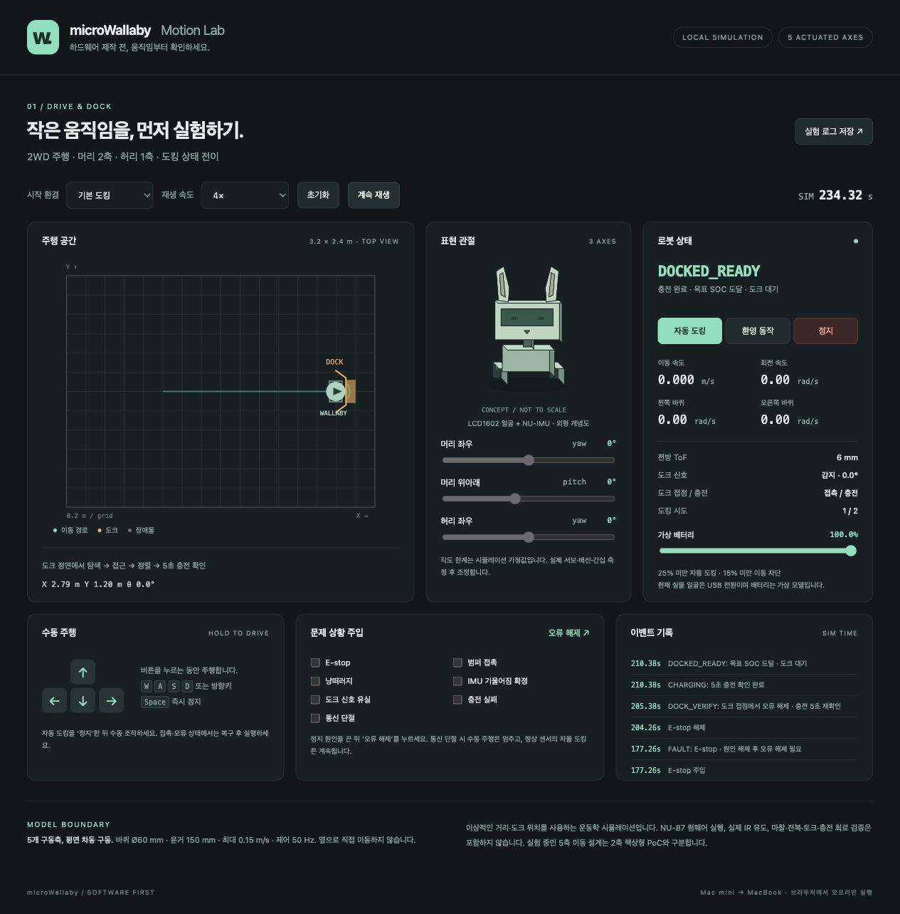

# Software simulation verification — 2026-10-09

Scope: hardware-free movement, expression, and docking preview in `simulation/`.
This checks a new conceptual JS model, not execution of NU-87 firmware.

## Environment

- Mac mini, macOS arm64
- Python 3.14.3, Node v25.8.1, native C compiler
- Codex in-app browser, localhost-only Python HTTP server
- Existing NU-87/Zephyr toolchain left independent of the simulation

## Automated checks

| Command | Result |
| --- | --- |
| `node --test simulation/model.test.mjs` | 21 passed, 0 failed |
| `node --check simulation/app.mjs` | Passed |
| `python3 -m py_compile simulation/serve.py simulation/package.py` | Passed |
| `make -C firmware/nu87_io_bringup/tests/host test` | Existing portable firmware logic PASS; sources also compiled separately by reviewer |
| `python3 simulation/package.py` | ZIP created; CRC and each allowlisted entry compared with final source |

Model cases cover straight/offset docking, five-second confirmation, beacon timeout and
loss/recovery, exactly two charging attempts, successful second attempt, safety fault
latches, manual network loss, autonomous operation without network, low/critical SOC,
explicit stop precedence, kinematics/units/limits, swept collisions against obstacles,
walls and dock, docked welcome bounds, fault recovery at contact, finite inputs and
determinism.

Nominal ideal-model runs reached charging around 31 simulated seconds. These are not
physical success-rate or real-time performance measurements.

## Browser checks

- Loaded browser modules and both canvases, rendered all controls and telemetry.
- Default docking progressed through approach, alignment, contact verification,
  charging and charged-ready states with wheel velocity zero at contact.
- Space stopped docking even with focus on the docking button.
- E-stop immediately produced `FAULT`; removing the flag alone left the latch active.
- Explicit recovery while docked restarted five-second verification and returned to
  charging/ready.
- Console inspection returned no warnings or errors in the validation tab.
- Full-page visual review found no clipped or overlapping controls at the tested
  desktop viewport. Mobile breakpoint styling is included but was not device-tested.

## Boundaries and delivery

The model uses ideal dock coordinates, a virtual charger, a circular footprint and
provisional joint limits. Retry assumes a passive 1 cm contact release. It does not
prove actual IR homing, NU-IMU/NU-87 driver operation, torque, friction, overturning,
charging electronics or physical assembly safety.

The checks above were completed locally before publication; they do not claim a
GitHub Actions result. The dedicated workflow runs after push. The portable ZIP is generated at
`simulation/dist/micro-wallaby-simulation.zip` and excluded from Git.
